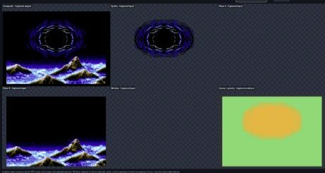
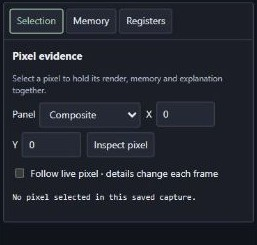
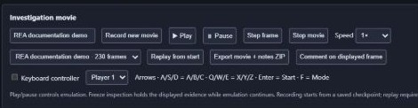
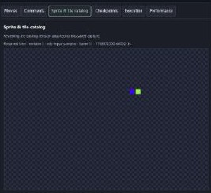

# MEGA REAPER - BlastEm

A Genesis / Mega Drive emulator adapted for AI-assisted reverse engineering, with direct VDP capture and six synchronized inspection views in one browser window.

Based on **BlastEm by Mike Pavone and contributors**, through the [ulalume/blastem](https://github.com/ulalume/blastem) debugging fork, base commit `5702187402276e7f0aea2ad4e6784ffb187c8c10`. Visit the [original BlastEm project](https://www.retrodev.com/blastem/) and its [official Mercurial source repository](https://www.retrodev.com/repos/blastem). The original emulator documentation remains in [README](README).

## What it shows

These features are included in **v0.5.0**. Click any crop to enlarge it.

| Feature | Cropped example |
| --- | --- |
| **One VDP atlas.** Compare Composite, sprites, Plane A, Plane B, Window and source priority from the same native frame. Open VRAM tiles or SAT bounds as copied-memory diagnostics. | <a href="docs/rea-features/graphics.jpg"></a> |
| **Selection, memory and execution.** Pin a pixel or memory baseline, inspect registers, restore named checkpoints, and run bounded experiments with two controller masks. Frame-sampled watches compare copied memory. | <a href="docs/rea-features/inspection.jpg"></a> |
| **Input movies.** Record both pads, play or step at the selected speed, and replay a saved log from its starting checkpoint. Use the browser keyboard controller or native input. The movie export combines the starting state, input log and associated notes. | <a href="docs/rea-features/movies.jpg"></a> |
| **Catalog and frame comments.** Build named entries from VDP selectors. Isolate sprite chains or Plane A, B and Window tiles, follow an occurrence, and attach its exact pinned capture to a comment during live play or read-only replay. Saved evidence retains the catalog revision, image and memory. Comments support Markdown, JSON and Mermaid. | <a href="docs/rea-features/catalog.jpg"></a> |

All six graphics views come from one emulation pass and travel together as one atlas. Captured colors preserve mid-frame palette, scrolling and Window changes. The isolated views show inputs before other layers hide them. Optional VRAM tiles and SAT bounds are separately labeled snapshot diagnostics; SAT rectangles are not gameplay hitboxes.

## Ready-to-run Windows build

Download the [v0.5.0 Windows x64 portable ZIP](https://github.com/Bertzerker/MEGA-REAPER-BlastEm/releases/download/mega-reaper-v0.5.0/MEGA-REAPER-BlastEm-0.5.0-windows-x64.zip), extract the entire archive, and double-click **MEGA REAPER.exe**. Choose a local ROM, then copy the inspector URL into the Codex in-app browser. Closing the launcher stops its emulator and server. [Release notes and checksum](https://github.com/Bertzerker/MEGA-REAPER-BlastEm/releases/tag/mega-reaper-v0.5.0)

The ZIP includes the compiled emulator, native launcher, REA interface, Node.js runtime, production dependencies, SDL2 and license notices. No Node installation, npm command, administrator access or PowerShell policy change is required. ROMs are not included.

## Run from source on Windows

Build `blastem-raster.exe` and place `SDL2.dll` beside it, following the [build instructions](rea/README.md#build-and-validate). Then run from the repository root:

```powershell
npm ci --prefix rea
npm run build:notes --prefix rea
./rea/Start-REA.ps1 -Rom 'C:/path/to/game.md'
```

Open **http://127.0.0.1:8765/** in the Codex in-app browser. The default browser-only display avoids a redundant native GPU presentation. The page has movie transport controls and an optional keyboard controller. Use `-NativeWindow` for a separate native game window with keyboard/gamepad interaction. Ctrl+C stops the launcher-owned emulator and inspector. The launcher rejects an already-running BlastEm instance.

## Document an investigation

Enter a title and choose **Record new movie**. Enable **Keyboard controller** to play in the browser, or use the native window's controller. **Pause** stops emulation, **Step frame** advances one frame, and **Speed** changes the emulation/playback rate. **Stop movie** closes the input log; select a saved movie and choose **Replay from start** to restore its starting checkpoint and replay its inputs.

Choose **Comment on displayed frame** to preserve that capture's composite render, six-view atlas and memory/register snapshot. Write Markdown, insert fenced JSON or Mermaid blocks, preview, then save. Comments stay linked to the movie ID, movie frame and capture ID. **Export movie + notes ZIP** downloads the checkpoint, input log, notes, PNGs and compressed snapshot JSON together. Everything is stored locally under `rea/session/`; ROMs are not included in exports.

Pixel selection pins its render and memory before showing details. **Inspect saved frame** reopens a comment's complete evidence in the atlas and side inspector, without seeking or restoring the machine. Notes can also document a live session without recording a movie. Unsaved drafts recover locally after switching/reload; revision conflicts preserve both texts for review.

Use **Add to catalog** from a selected sprite or tile pixel to create a named entry or append an animation variant. **Show all matches** isolates captured samples, and **Follow instance** tracks one occurrence. **Attach to comment** preserves that capture and catalog revision during live play or replay. [Catalog walkthrough](rea/README.md#sprite-and-tile-catalog)

**Collision** overlays Elemental Master (USA) player, contact object and pickup boxes on Composite. The profile reads the game's collision operands from the displayed frame's work RAM. A Stage 1 replay verified an 8×16 player box against a 24×24 enemy through a one-pixel near miss and a one-pixel overlap that reduced health. [Collision profile and replay evidence](rea/COLLISION.md)

**Checkpoints** and **Execution** are separate from movie playback. The protocol-2 native bridge can pause/save a named compatible checkpoint, restore it, and run 1–3600 video frames with two controller masks. Copied-memory watches stop at explicit capture/event limits. Use the native debugger for instruction tracing.

Movies currently support standard Genesis cartridges with two 3/6-button controllers. Replay requires the exact ROM and emulator executable used for recording. This first movie implementation does not include rerecording, editable input timelines, rewind or movies from other emulator formats. See [movie details and limitations](rea/README.md#movies-and-frame-comments).

No commercial ROMs, local captures, dependency downloads or compiled binaries are included. Supply your own ROM locally.

## Performance and validation

The previously measured Windows configuration sustained **59.92 unique updates/s** across all six views over three minutes with Elemental Master (USA), with zero native capture gaps, delivery skips, browser drops or underruns. The highest sampled p95 frame interval was **17.1 ms**. This is the Genesis NTSC source rate. The presentation buffer adds about 100 ms of latency. A separate short H40 diagnostic run with active v0.4.0 catalog requests delivered about 60 atlas packets per second with zero native gaps or server skips.

The implementation uses specialized capture writes, touched-row resets, a persistent nonblocking TCP stream, lossless pixel-run atlas transport and one WebGL canvas. Thirty-five JavaScript tests, native capture tests, and H40/H32 diagnostic ROM checks validate the implementation. See [measurements, supported modes and limitations](rea/README.md).

```powershell
npm test --prefix rea
```

The [specification](rea/SPEC.md) records delivered features and future work, including instruction/DMA provenance, replay tracing and game-specific collision adapters. Automatic hitbox recovery and a complete AI analysis agent are not implemented.

## License and attribution

- **Original emulator:** [BlastEm](https://www.retrodev.com/blastem/) by Mike Pavone and contributors supplies the emulation core. Its official source is hosted in [Mercurial on retrodev.com](https://www.retrodev.com/repos/blastem).
- **Immediate upstream:** [ulalume/blastem](https://github.com/ulalume/blastem) adds the GDB remote, scriptable control socket and embedded UI font that this project builds on.
- **MEGA REAPER additions:** direct VDP capture, the synchronized six-view REA inspector, inspection API, transport optimizations and portable Windows launcher/package.

GitHub shows this repository as a fork of `ulalume/blastem`, our immediate upstream. That badge identifies the GitHub fork relationship; the original BlastEm project is hosted outside GitHub. MEGA REAPER is a derivative project, independently maintained from the original BlastEm project.

Distributed under **GPL-3.0-or-later**; see [COPYING](COPYING). Preserve the upstream notices and [COPYING.fork](COPYING.fork), which covers ulalume's public-domain dedication for that fork's own changes. MEGA REAPER's REA additions remain GPL-3.0-or-later. The bundled Inter typeface retains its [SIL Open Font License](nuklear_ui/Inter-LICENSE.txt).
